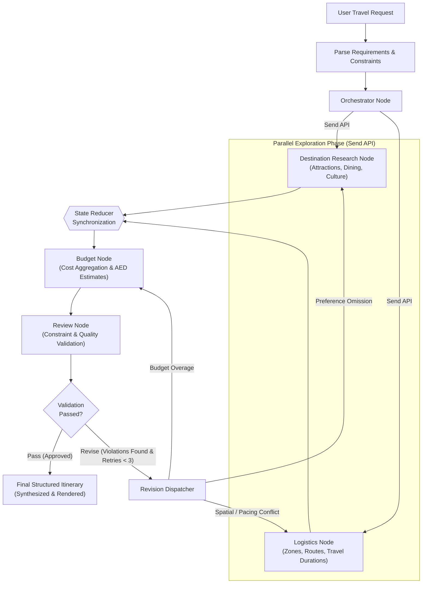

# Dubai AI Travel Planning System — LangGraph Multi-Agent Architecture

## 1. Background

Planning a trip involves multiple interconnected decisions, including:
* Selecting attractions and cultural experiences
* Finding suitable accommodation
* Organizing transportation and optimizing routes
* Estimating and managing expenses
* Ensuring the final itinerary aligns with the traveler's personal preferences and constraints

A traditional single-prompt AI chatbot generates an itinerary in a single unverified response, but suffers from critical limitations:
* It does not verify travel times or geographical feasibility.
* It cannot reliably calculate or enforce budget constraints.
* It lacks systematic validation of recommendations against authoritative data sources.
* It cannot self-correct or backtrack when constraints are violated.

This project implements a **stateful, graph-based multi-agent system using LangGraph**, demonstrating how specialized AI agent nodes collaborate over a centralized state with deterministic validation and iterative feedback loops to solve real-world travel planning.

---

## 2. Problem Statement

> **Objective:** Build a Dubai-focused AI Travel Planning System using **LangGraph** that converts a natural-language travel request into a personalized, budget-conscious, and practical travel itinerary.

Instead of relying on a monolithic AI prompt, the planning process is partitioned across specialized agent nodes coordinated within a stateful directed graph:
* **Destination Research:** Discovery of cultural landmarks, dining, and attractions tailored to user interests and crowd preferences.
* **Logistics & Routing:** Geographic clustering, transit calculations (Metro, taxi, walking), and accommodation zone selection.
* **Financial Auditing:** Expense aggregation in AED, budget compliance tracking, and alternative cost-saving recommendations.
* **Quality Assurance & Validation:** Rigorous rule-based and LLM-driven verification with automated cycle revision when constraints fail.

> [!NOTE]
> The primary goal is not to build a commercial travel-booking platform, but to demonstrate how stateful graph-based multi-agent architectures (LangGraph) solve complex planning problems through coordinated state transitions, parallel fan-out, and deterministic feedback loops.

---

## 3. Example User Request

### Sample Input Prompt
> *"Plan a 4-day trip to Dubai with a budget of AED 5,000, excluding flights. I enjoy cultural attractions, local food, and beaches. I prefer affordable hotels and want to avoid crowded places."*

### Expected System Outputs
* **Personalized Day-by-Day Itinerary:** Detailed daily schedule with morning, lunch, afternoon, and evening activities with realistic pacing.
* **Curated Recommendations:** Tailored attractions, restaurants, cultural heritage sites, and accommodation zones.
* **Logistics & Transit Details:** Feasible transit options (Dubai Metro, RTA bus, taxi, abra) and realistic travel duration estimates.
* **Category-Wise Budget Breakdown:** Detailed expenditure estimates in AED across accommodation, dining, activities, and transit.
* **Automated Alternatives:** Fallback options and substitutions automatically generated when proposed plans exceed budget or violate constraints.
* **Validated Final Itinerary:** A verified plan cross-checked against user preferences, opening hours, schedule feasibility, and financial constraints.

---

## 4. Multi-Agent System Design

The LangGraph architecture employs five specialized agent nodes operating over a shared state (`TravelPlanState`):

| Agent / Node | Role | Core Responsibilities |
| :--- | :--- | :--- |
| **Agent 1 — Orchestrator Node** | Coordinator & Parser | Ingests natural-language prompts, extracts constraints (budget, days, interests, crowd preference), initializes graph state, and compiles the final deliverable. |
| **Agent 2 — Destination Research Node** | Tourism & Domain Specialist | Researches Dubai attractions, cultural experiences, culinary spots, and neighborhoods; selects activities based on user interests and crowd preferences. |
| **Agent 3 — Logistics Node** | Spatial & Routing Optimizer | Evaluates neighborhood hotel zones, calculates inter-activity distances and transit times, selects transit modes, and sequences daily plans geographically. |
| **Agent 4 — Budget Node** | Financial Auditor | Aggregates lodging, dining, transit, and admission costs in AED; validates against the budget ceiling; generates cheaper substitutions when over budget. |
| **Agent 5 — Review Node** | Quality Assurance & Gatekeeper | Evaluates the draft itinerary against strict constraints; passes valid plans or routes back to specific upstream nodes with actionable feedback. |

---

## 5. Dubai Travel Data — Sources and Integration

The system combines publicly available Dubai datasets, external APIs, and a curated local knowledge base.

### Data Sources Matrix

| Data Requirement | Proposed Source | Usage |
| :--- | :--- | :--- |
| **Attractions & Tourism Information** | Visit Dubai & Data.Dubai / Dubai Pulse | Research attractions, neighborhoods, opening hours, and cultural experiences. |
| **Restaurants & Location Details** | Curated Seed DB & OpenStreetMap / Overpass | Discover places, categories, geographic coordinates, ratings, and venue details. |
| **Routes & Transportation** | Official Dubai RTA Information & Free OSRM Routing | Estimate transit distances, journey durations, transit options, and public transport fares. |
| **Accommodation** | Curated Hotel Dataset by Neighborhood Zone | Suggest neighborhood accommodation zones and estimate lodging costs by tier. |
| **Activity & Dining Costs** | Published attraction rates & curated AED price tiers | Provide realistic pricing estimates for meals, tickets, and activities. |
| **Weather *(Optional)*** | Open-Meteo API | Provide weather-aware recommendations for seasonal outdoor and indoor activities. |

### Data Integration Approach
* **Local-First Knowledge Base:** Pre-seeded curated Dubai database (SQLite) containing 50+ attractions, 40+ dining venues, 6 hotel zones, and precomputed transit matrices for 100% reliable, zero-latency demos.
* **Free Open Routing & Discovery:** Free OSRM (Open Source Routing Machine) and OpenStreetMap / Overpass for road routing and spatial discovery with zero API fees.
* **Official Fare & Cost Standards:** Strict integration of official RTA fare tiers (Dubai Metro Zones 1–3, taxi tariffs) and published attraction admissions.
* **Data Transparency:** Clear provenance tagging (`SEED_DATABASE`, `OPEN_METEO`, `RTA_OFFICIAL`, `OPEN_STREET_MAP`, `OSRM_ROUTING`, `LLM_ESTIMATE`) so users know data origins.
* **Graceful Degradation:** Automatic fallback to local SQLite datasets if external APIs encounter rate limits or missing keys.
* **Scope Boundary:** Live booking transactions, ticket purchasing, and guaranteed real-time availability are strictly outside project scope.

---

## 6. LangGraph Orchestration Architecture

The system is constructed as a **Stateful Cyclic Computation Graph** (`StateGraph`) built on LangGraph:

```
               +---------------------------------------------+
               |             User Travel Request             |
               +---------------------------------------------+
                                      |
                                      v
               +---------------------------------------------+
               |        Parse & Constraint Extraction        |
               +---------------------------------------------+
                                      |
                         [Parallel Fan-Out (Send API)]
                         /                           \
                        v                             v
           +-------------------------+   +-------------------------+
           |   Destination Research  |   |    Logistics & Zones    |
           |     (Attractions & Food)|   |   (Transit & Clustering)|
           +-------------------------+   +-------------------------+
                        \                             /
                         [State Reducer Synchronization]
                                      |
                                      v
               +---------------------------------------------+
               |            Budget Calculation Node          |
               |       (Cost Aggregation in AED + Alt)       |
               +---------------------------------------------+
                                      |
                                      v
               +---------------------------------------------+
               |            Review & Validation Node         |
               |        (Rule Engine + LLM Evaluation)       |
               +---------------------------------------------+
                                      |
                              [Conditional Edge]
                                 /          \
                     Approved   /            \  Violations Detected
                               v              v
                  +-------------------+   +-------------------------+
                  |  Final Itinerary  |   |   Revision Dispatcher   |
                  |     Synthesis     |   |   (Route to Target Node)|
                  +-------------------+   +-------------------------+
                                                       |
                                           (Loop Back: max 3 cycles)
```

### Core LangGraph Architectural Primitives
1. **Centralized Typed State (`TravelPlanState`):** TypedDict with explicit field types and annotated reducers (`Annotated[list, operator.add]`) to support clean state merging.
2. **Parallel Fan-Out (`Send` API):** Concurrent execution of Destination Research and Logistics nodes to minimize overall end-to-end latency.
3. **Deterministic Constraint Gate:** Combining deterministic Python rule checking with LLM reasoning at the Review node.
4. **Conditional Cyclic Routing:** Dynamic edges that inspect validation feedback and cycle back to the offending agent node with actionable revision context.
5. **State Checkpointing & Replay:** In-memory checkpointer (`MemorySaver`) enabling step-by-step state inspection, execution time-travel, and human-in-the-loop overrides.

---

## 7. End-to-End Workflow



### Execution Visibility
The demonstration interface visualizes:
1. **Active Node State:** Real-time visual tracking of active graph nodes during execution.
2. **State Mutation Timeline:** Inspection of state changes at every transition point.
3. **Revision Diff Visualization:** Visual diff showing how the itinerary adapts when the Review node triggers a revision cycle.

---

## 8. Technology Stack

* **Development Environment:** Cursor IDE
* **Programming Language:** Python 3.10+
* **Orchestration Framework:** **LangGraph** (StateGraph, Send API, conditional edges, MemorySaver)
* **LLM Layer:** Configurable LLM provider (Google Gemini, OpenAI, Anthropic, or local models via Ollama)
* **User Interface:** Streamlit (interactive itinerary studio, real-time node trace inspector, interactive map)
* **Data Storage:** SQLite / JSON with free external integrations (Open-Meteo, OSRM, OpenStreetMap)
* **Data Validation:** Pydantic v2 schemas and deterministic rule-based constraint verifications

---

## 9. MVP Scope & Success Criteria

### Initial Scope Boundaries
* **Target Destination:** Dubai, United Arab Emirates exclusively.
* **Trip Duration:** Short trips spanning 1 to 7 days.
* **Currency:** Budget modeling and breakdown strictly in AED (United Arab Emirates Dirham).

### Success Criteria
The project is considered successful when it demonstrably achieves:
1. **Natural-Language Understanding:** Accurately converts free-form travel requests into structured constraints and a day-by-day Dubai itinerary.
2. **Stateful Graph Execution:** Demonstrates coordinated execution across all 5 agent nodes within a single LangGraph `StateGraph`.
3. **Parallel Optimization:** Successfully fans out Destination and Logistics exploration concurrently via LangGraph's `Send` API.
4. **Autonomous Self-Correction:** Automatically detects constraint violations (budget overrun, excessive transit) and successfully resolves them via the review-revise feedback loop.
5. **Full Observability:** Visualizes the complete graph execution trace, state mutations, and revision diffs in the Streamlit UI.

---

## 10. Expected Outcome

A fully functional, interactive LangGraph multi-agent prototype that provides technical and non-technical stakeholders with clear, observable insights into:
* **Agent Specialization:** Decomposing complex travel planning into focused, modular nodes.
* **State Management:** Maintaining a clean, typed centralized state with safe concurrent updates.
* **Dynamic Routing & Cycles:** Using conditional edges to implement robust, self-correcting agentic workflows.
* **Hybrid Validation:** Combining fast deterministic Python rules with LLM intelligence to eliminate hallucinations and enforce strict budget compliance.
