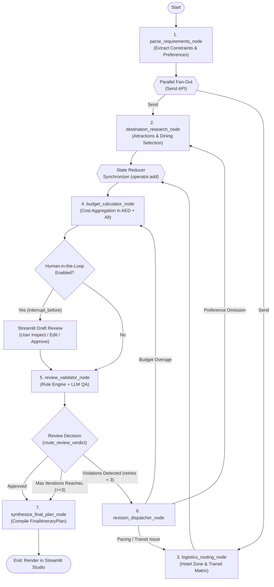

# 🇦🇪 Dubai AI Travel Planning System
### Autonomous Multi-Agent Itinerary Orchestrator powered by LangGraph

---

[](https://www.python.org/downloads/)
[](https://github.com/langchain-ai/langgraph)
[](https://streamlit.io/)
[](#100-free-open-source-data-layer)
[](#testing--verification)

The **Dubai AI Travel Planning System** is a production-grade multi-agent platform designed to convert natural-language travel requests into realistic, budget-verified, geographically sequenced, and time-optimized itineraries for Dubai, UAE.

The system is architected around **LangGraph** as its sole multi-agent orchestration engine. By modeling the travel planning workflow as a **stateful, cyclic computational graph (`StateGraph`)**, the platform achieves deterministic coordination, fine-grained control flow, concurrent fan-out, and robust self-correction feedback loops.

---

## 🌟 Key Architectural Tenets

- **100% Free & Open-Source Stack:** Strictly zero reliance on commercial, paid, or credit-card-gated APIs (e.g., Google Places, Google Routes, or Amadeus). All data is retrieved from local curated databases, official open government data, and unmetered open APIs.
- **Centralized Typed State:** A single source of truth (`TravelPlanState`) passed across graph nodes, leveraging annotated reducers (`operator.add`) for safe concurrent updates.
- **Parallel Fan-Out via `Send` API:** Dynamic concurrent execution of destination research and logistics evaluations to minimize end-to-end latency.
- **Deterministic Validation & Self-Correction:** A dedicated QA node pairing deterministic rule engines with LLM reasoning to catch budget, pacing, and transit violations, looping back with targeted revision instructions (capped at 3 iterations).
- **Decoupled Data Layer:** Local-first SQLite seed database (52+ POIs, 42+ restaurants, 6 hotel zones, RTA transit matrix), Open-Meteo weather forecasts, and OSRM road routing with mathematical Haversine fallbacks.
- **Data Provenance:** Every cost estimate and activity recommendation carries an explicit source tag (`SEED_DATABASE`, `OPEN_METEO`, `RTA_OFFICIAL`, `OPEN_STREET_MAP`, `OSRM_ROUTING`, `LLM_ESTIMATE`).
- **Human-in-the-Loop Support:** Native LangGraph graph interrupts (`interrupt_before=["review_validator_node"]`) allowing travelers to inspect, modify, or approve intermediate draft plans before final validation.
- **Observability & Traceability:** Real-time capture of node execution states, state mutations, token usage, latency, and revision diffs visualized in an interactive Streamlit UI.

---

## 🏗️ High-Level System Architecture



---

## 📂 Repository Structure

```
Multi Agent/
├── app/
│   ├── main.py                     # Streamlit application entry point & HITL controller
│   ├── components/                 # Reusable UI dashboard components
│   │   ├── itinerary_view.py       # Day-by-day cards & markdown/JSON export
│   │   ├── budget_charts.py        # Plotly donut & daily spend progression charts
│   │   ├── map_view.py             # Interactive Folium & PyDeck route visualizer
│   │   ├── trace_viewer.py         # Graph node execution stepper & state inspector
│   │   └── profiler_view.py        # Latency, token metrics & provenance dashboard
│   └── styles/
│       └── custom.css              # Custom styling & provenance pill badges
│
├── configs/
│   ├── settings.py                 # Pydantic BaseSettings (runtime configuration)
│   ├── llm_factory.py              # LLM client factory (Google Gemini, OpenAI, Ollama)
│   └── dubai_constants.py          # RTA transit fares, zone baselines, currency ratios
│
├── data/
│   ├── seed/
│   │   ├── attractions.json        # 52+ curated Dubai attractions with lat/lng & costs
│   │   ├── restaurants.json        # 42+ curated dining venues categorized by price tier
│   │   ├── hotel_zones.json        # Nightly hotel baselines across 6 neighborhoods
│   │   └── transit_matrix.json     # Zone-to-zone RTA Metro & Taxi transit matrix
│   ├── database/
│   │   └── dubai_travel.db         # Persistent SQLite database
│   └── build_seed_db.py            # SQLite ingestion script
│
├── src/
│   ├── models/                     # Shared Pydantic v2 domain schemas
│   │   ├── request.py              # UserTravelRequest
│   │   ├── itinerary.py            # DailyPlan, ActivityItem, TransitSegment
│   │   ├── budget.py               # BudgetSummary, AlternativeOption
│   │   ├── review.py               # ReviewResult
│   │   ├── metrics.py              # GraphExecutionMetrics, NodeExecutionMetric
│   │   └── enums.py                # DataSource enum provenance tags
│   │
│   ├── data_access/                # 100% Free Data Layer
│   │   ├── repository.py           # Unified repository facade
│   │   ├── sqlite_client.py        # Local SQLite database client
│   │   ├── cache.py                # In-memory TTL cache
│   │   ├── osrm_client.py          # Free OSRM road routing + Haversine fallback
│   │   ├── open_meteo.py           # Free weather forecasts client
│   │   └── osm_client.py           # OpenStreetMap POI discovery
│   │
│   ├── tools/                      # Agent Tools & Rule Engines
│   │   ├── search_tools.py         # Attraction & restaurant search
│   │   ├── route_tools.py          # Distance, transit, and RTA fare calculations
│   │   └── validation_engine.py    # Deterministic 5-rule validation engine
│   │
│   ├── prompts/                    # LLM prompt templates & role definitions
│   │   ├── orchestrator_prompt.py  # Constraint extraction prompt
│   │   ├── destination_prompt.py   # POI research & curation prompt
│   │   ├── logistics_prompt.py     # Transit routing prompt
│   │   ├── budget_prompt.py        # Cost analysis prompt
│   │   └── review_prompt.py        # QA auditor prompt
│   │
│   ├── graph/                      # LangGraph Core Multi-Agent Engine
│   │   ├── state.py                # TypedDict TravelPlanState with annotated reducers
│   │   ├── nodes.py                # Specialized Agent Node functions
│   │   ├── edges.py                # Routing functions & Send API fan-out
│   │   ├── checkpointer.py         # MemorySaver checkpointing configuration
│   │   └── builder.py              # StateGraph assembly & compilation
│   │
│   └── utils/
│       ├── logger.py               # Structured logging & trace capture
│       ├── profiler.py             # Latency, token count, and cost calculators
│       └── error_handler.py        # Graceful fallbacks & schema repairs
│
├── tests/                          # Automated Pytest Suite (40 tests)
│   ├── test_rule_engine.py         # Deterministic validation rules
│   ├── test_data_repository.py     # Local DB & caching behavior
│   ├── test_nodes.py               # Individual agent node execution
│   ├── test_parallel_fanout.py     # Concurrency via Send API
│   ├── test_review_cycle.py        # Self-correction loop & ceiling guards
│   ├── test_graph_flow.py          # Complete graph invocation & HITL pause/resume
│   ├── test_ui_components.py       # Streamlit chart & summary rendering
│   ├── test_end_to_end_scenarios.py# Multi-scenario stress tests (1-7 days, budget, luxury)
│   └── test_offline_resilience.py  # 100% offline network failure fallback verification
│
├── architecture.md                 # System Architecture & Detailed Specification
├── playbook.md                     # Runtime Lifecycle & Execution Playbook
├── ProblemStatement.md             # Functional requirements & constraint definitions
├── requirements.txt                # Python package dependencies
└── README.md                       # Documentation & setup guide (this document)
```

---

## ⚡ Quickstart & Setup Guide

### 1. Prerequisites
- **Python 3.10, 3.11, or 3.12**
- Git

### 2. Environment Setup
```bash
# Clone the repository
git clone <repo-url>
cd "Multi Agent"

# Create a virtual environment
python -m venv .venv

# Activate virtual environment
# Windows (PowerShell):
.venv\Scripts\Activate.ps1
# Linux / macOS:
source .venv/bin/activate

# Install dependencies
pip install -r requirements.txt
```

### 3. Environment Variables Configuration
Copy the template `.env.example` into `.env`:
```bash
cp .env.example .env
```
Edit `.env` (optional):
```env
# Primary LLM Provider (Optional: operates 100% offline if no API key is provided)
LLM_PROVIDER=google
LLM_MODEL_NAME=gemini-2.5-flash

# API Keys
GOOGLE_API_KEY=your_google_api_key_here
GROQ_API_KEY=your_groq_api_key_here

# Feature Flags
ENABLE_WEATHER_INTEGRATION=true
ENABLE_OSRM_ROUTING=true
ENABLE_HUMAN_IN_THE_LOOP=false
```
> [!NOTE]
> The system includes a full deterministic fallback engine. If no LLM API key is configured, the system executes completely offline using local regex parsers, curated SQLite databases, and official RTA transit matrices.

### 4. Seed Database Ingestion
Populate the local SQLite database from curated JSON seeds:
```bash
python data/build_seed_db.py
```

---

## 🖥️ How to Run

### Option A: Interactive Streamlit Studio (Recommended)
Launch the full presentation layer with live graph streaming:
```bash
streamlit run app/main.py
```
Open your browser at `http://localhost:8501`.

**Features in Streamlit:**
- **Sidebar:** Choose prompt templates or enter custom requests, fine-tune budget sliders, duration, pace, and toggle Human-in-the-Loop review.
- **Tab 1 (Final Itinerary Plan):** View daily schedules, Nol transit guidance, provenance tags, and Plotly financial charts. Export as Markdown or JSON.
- **Tab 2 (Graph Node Trace Viewer):** Inspect step-by-step agent node execution traces, state mutations, and QA reviewer feedback.
- **Tab 3 (Map & Route Visualizer):** View interactive color-coded Folium/PyDeck maps showing daily activity clusters and transit flow.
- **Tab 4 (Performance & Profiler):** Deep-dive into execution latency per node, token economics, and information provenance ratios.

---

### Option B: Headless Programmatic Invocation (CLI / Script)
Run the multi-agent graph directly in Python:
```python
import uuid
from src.graph.builder import build_travel_planner_graph
from src.graph.state import create_initial_state

# 1. Compile the graph
app = build_travel_planner_graph(enable_hitl=False)

# 2. Setup thread ID for state checkpointing
thread_id = str(uuid.uuid4())
config = {"configurable": {"thread_id": thread_id}}

# 3. Define initial input prompt
initial_input = create_initial_state(
    "Plan a 4-day trip to Dubai with a budget of AED 5,000, excluding flights. "
    "I enjoy cultural attractions, local food, and beaches. "
    "I prefer affordable hotels and want to avoid crowded places."
)

# 4. Invoke graph execution
final_state = app.invoke(initial_input, config=config)

# 5. Access final structured deliverable
plan = final_state.get("final_plan")
print(f"Trip Title: {plan.trip_title}")
print(f"Total Cost: AED {plan.budget_breakdown.total_cost:,.2f}")
print(f"Days Scheduled: {len(plan.days)}")
```

---

## 🧪 Testing & Verification

The project includes an automated test suite of **40 tests** covering domain models, data access, rule engines, parallel execution, self-correction loops, and UI components:

```bash
pytest -v
```

### Test Suite Structure:
| Test File | Scope / Purpose |
| :--- | :--- |
| `tests/test_rule_engine.py` | 5 deterministic constraint validation rules |
| `tests/test_data_repository.py` | SQLite queries, TTL cache expiry, and Haversine math |
| `tests/test_nodes.py` | Node logic across Orchestrator, Destination, Logistics, Budget, and QA |
| `tests/test_parallel_fanout.py` | Concurrency and `operator.add` reducer merging via `Send` API |
| `tests/test_review_cycle.py` | Conditional edge decisions, targeted re-work dispatch, and 3-iteration cap |
| `tests/test_graph_flow.py` | End-to-end execution and Human-in-the-Loop pause/resume |
| `tests/test_ui_components.py` | Plotly charts, markdown export, and provenance HTML pills |
| `tests/test_end_to_end_scenarios.py` | Multi-scenario stress tests (budget-tight, culture, luxury, 1-day, 7-day) |
| `tests/test_offline_resilience.py` | 100% offline functionality during simulated network outages |

---

## 🛡️ Deterministic Validation Engine (5 Rules)

To prevent LLM hallucinations and enforce real-world feasibility, the **Review Node** executes a deterministic Python rule engine before qualitative synthesis:

1. **Total Budget Check:** Total expenses (lodging + dining + activities + transit + 10% contingency buffer) $\le$ User Budget in AED.
2. **Transit Feasibility:** Consecutive activities within the same half-day must either reside in the same neighborhood cluster or have a transit duration $< 45$ minutes.
3. **Pacing Constraints:** Total scheduled active hours per day must not exceed $8.5$ hours.
4. **Mandatory Preferences:** If user requested "beaches", at least one beach activity must be present; if "culture", historic districts (e.g., Al Fahidi, Al Seef, Dubai Museum) must be scheduled.
5. **Deduplication:** No tourist attraction or restaurant can appear more than once across the entire duration.

---

## 🏷️ Data Provenance & Trust

Every activity and transit recommendation in the final itinerary carries an explicit source badge:

| Provenance Tag | Source | Verifiability |
| :--- | :--- | :--- |
| `SEED_DATABASE` | Local SQLite DB (`dubai_travel.db`) | Curated, verified Dubai POIs & restaurant baselines |
| `RTA_OFFICIAL` | Dubai Roads & Transport Authority | Official zone-to-zone Metro and Bus tariff matrices |
| `OPEN_METEO` | Open-Meteo Weather API | Unmetered open forecasts (temperature, UV index, rain) |
| `OSRM_ROUTING` | Open Source Routing Machine | Real-world driving distances and transit durations |
| `LLM_ESTIMATE` | AI Generator | Fallback heuristic approximation |

---

## 🚀 Deployment

For comprehensive deployment instructions covering **Streamlit Community Cloud**, **Docker & Docker Compose**, **Production Linux VMs (Systemd + Nginx + SSL)**, **Google Cloud Run**, and **PaaS (Render, Railway, Hugging Face)**, refer to the dedicated guide:

👉 **[Read the Full Deployment Guide (deployment.md)](file:///c:/Users/jaya.manocha/Documents/myProjects/Multi%20Agent/deployment.md)**

Quick local container launch:
```bash
docker compose up -d --build
```

---

## 📄 License
This project is open-source under the MIT License.
