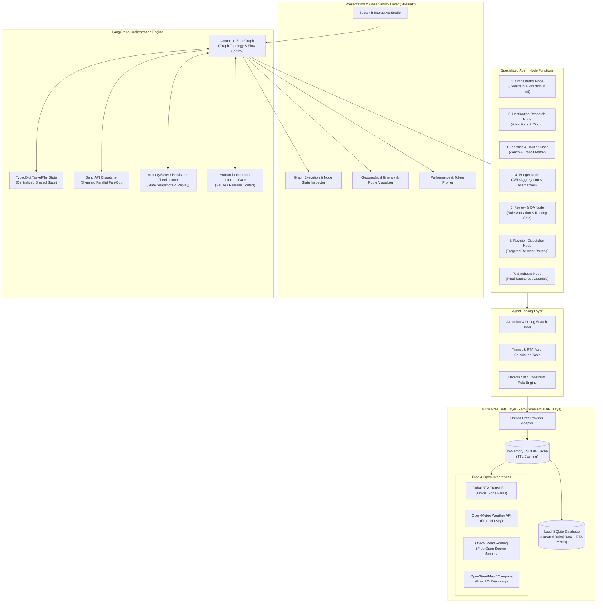
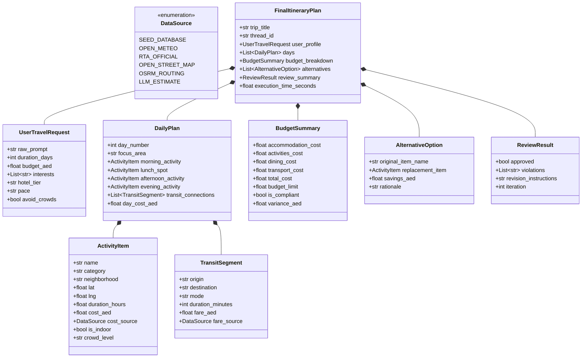
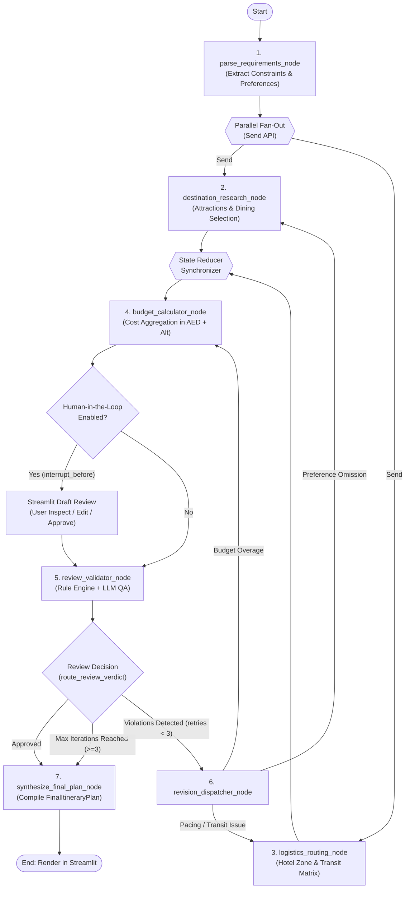
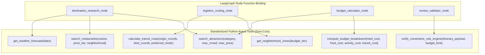
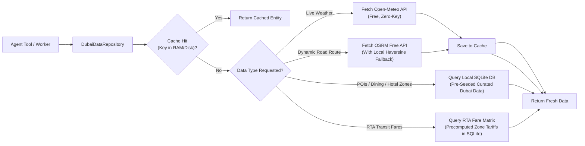
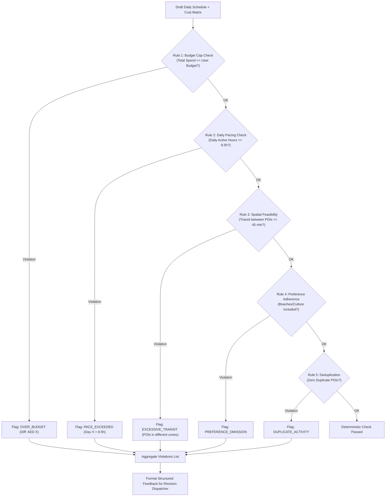
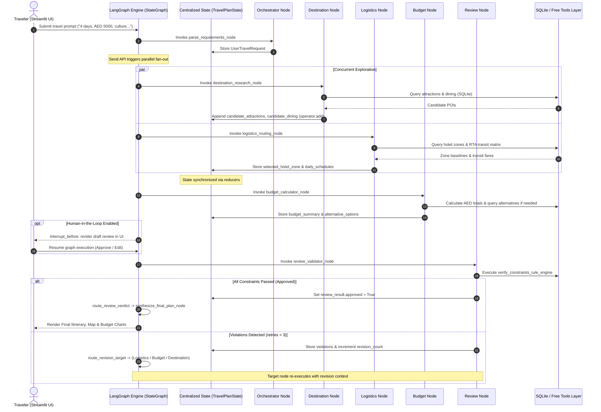
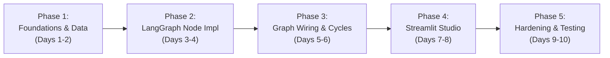

# System Architecture Document
## Dubai AI Travel Planning System (LangGraph Multi-Agent Architecture)

---

## 1. Executive Summary & Architectural Goals

The **Dubai AI Travel Planning System** is an extensible, production-ready multi-agent platform designed to convert natural-language travel requests into realistic, budget-verified, and geographically sequenced itineraries for Dubai, UAE.

The system is architected around **LangGraph** as its sole multi-agent orchestration engine. By modeling the entire planning workflow as a **stateful, cyclic computational graph (`StateGraph`)**, the application achieves deterministic coordination, fine-grained control flow, concurrent fan-out, and robust self-correction loops.

### Key Architectural Tenets
* **100% Free & Open-Source Stack:** Strictly zero reliance on commercial, paid, or credit-card-gated APIs (such as Google Places, Google Routes, or Amadeus). All data is retrieved from local curated databases, official open government data, and unmetered open APIs.
* **Centralized Typed State:** A single source of truth (`TravelPlanState`) passed between graph nodes, leveraging annotated reducers for safe parallel updates.
* **Parallel Fan-Out via `Send` API:** Concurrent execution of destination research and logistics evaluations to minimize end-to-end latency.
* **Deterministic Validation & Self-Correction:** A dedicated Quality Assurance node pairing deterministic rule engines with LLM reasoning to catch violations and loop back with actionable revision instructions.
* **Decoupled Data Layer:** Repository pattern with local-first SQLite seed data and free open integrations (official Dubai RTA transit matrices, Open-Meteo weather forecasts, and OSRM / Haversine road routing).
* **Data Provenance:** Every cost estimate and activity recommendation carries an explicit source tag (`SEED_DATABASE`, `OPEN_METEO`, `RTA_OFFICIAL`, `OPEN_STREET_MAP`, `OSRM_ROUTING`, `LLM_ESTIMATE`) ensuring total transparency.
* **Human-in-the-Loop Support:** Native LangGraph graph interrupts (`interrupt_before`) allowing travelers to inspect, modify, or approve intermediate draft plans before final review.
* **Observability & Traceability:** Real-time capture of node execution states, state mutations, token usage, latency, and revision diffs visualized in an interactive Streamlit UI.

### Explicit Scope Exclusions
The following are **not** in scope for the MVP:
* Paid commercial APIs (Google Maps Platform, Amadeus, etc.).
* Live hotel booking or ticket purchasing transactions.
* Guaranteed real-time pricing or live room inventory.
* Multi-destination planning outside Dubai.
* Flight booking or airport transfer logistics.
* User authentication or session persistence across browser reloads.

---

## 2. High-Level System Architecture

The system follows a layered architecture comprising the **Presentation Layer (Streamlit)**, the **LangGraph Orchestration Engine**, the **Agent Node Functions & Tooling**, and the **Free Data Layer**.



---

## 3. Core Domain Models & Schemas

All entities conform to strict **Pydantic v2** models, ensuring runtime type safety and clear schema definitions across nodes, tools, and the UI.



### Python Schema Implementations (Pydantic v2)

```python
from typing import List, Optional, Literal
from enum import Enum
from pydantic import BaseModel, Field

class DataSource(str, Enum):
    SEED_DATABASE = "seed_database"       # Pre-verified curated local SQLite data
    OPEN_METEO = "open_meteo"             # Free Open-Meteo weather forecast
    RTA_OFFICIAL = "rta_official"         # Official Dubai RTA fare tables in SQLite
    OPEN_STREET_MAP = "open_street_map"   # Free OpenStreetMap / Overpass API
    OSRM_ROUTING = "osrm_routing"         # Free OSRM road routing engine
    LLM_ESTIMATE = "llm_estimate"         # LLM approximation

class UserTravelRequest(BaseModel):
    raw_prompt: str
    duration_days: int = Field(default=4, ge=1, le=7)
    budget_aed: float = Field(default=5000.0, gt=0)
    interests: List[str] = Field(default_factory=list)
    hotel_tier: Literal["budget", "midscale", "luxury"] = "budget"
    pace: Literal["relaxed", "moderate", "fast-paced"] = "moderate"
    avoid_crowds: bool = True

class ActivityItem(BaseModel):
    name: str
    category: Literal["culture", "beach", "dining", "sightseeing", "shopping", "adventure"]
    neighborhood: str
    lat: float
    lng: float
    duration_hours: float
    cost_aed: float
    cost_source: DataSource = DataSource.SEED_DATABASE
    is_indoor: bool
    crowd_level: Literal["low", "medium", "high"]

class TransitSegment(BaseModel):
    origin: str
    destination: str
    mode: Literal["metro", "bus", "taxi", "walking", "abra"]
    duration_minutes: int
    fare_aed: float
    fare_source: DataSource = DataSource.RTA_OFFICIAL

class DailyPlan(BaseModel):
    day_number: int
    focus_area: str
    morning_activity: ActivityItem
    lunch_spot: ActivityItem
    afternoon_activity: ActivityItem
    evening_activity: ActivityItem
    transit_connections: List[TransitSegment]
    day_cost_aed: float

class BudgetSummary(BaseModel):
    accommodation_cost: float
    activities_cost: float
    dining_cost: float
    transport_cost: float
    total_cost: float
    budget_limit: float
    is_compliant: bool
    variance_aed: float

class AlternativeOption(BaseModel):
    original_item_name: str
    replacement_item: ActivityItem
    savings_aed: float
    rationale: str

class ReviewResult(BaseModel):
    approved: bool
    violations: List[str] = Field(default_factory=list)
    revision_instructions: Optional[str] = None
    iteration: int = 1

class FinalItineraryPlan(BaseModel):
    trip_title: str
    thread_id: str
    user_profile: UserTravelRequest
    days: List[DailyPlan]
    budget_breakdown: BudgetSummary
    alternatives: List[AlternativeOption] = Field(default_factory=list)
    review_summary: ReviewResult
    execution_time_seconds: float

class NodeExecutionMetric(BaseModel):
    node_name: str
    latency_seconds: float
    tokens_input: int
    tokens_output: int
    estimated_cost_usd: float

class GraphExecutionMetrics(BaseModel):
    thread_id: str
    total_latency_seconds: float
    node_metrics: List[NodeExecutionMetric]
    revision_count: int
    budget_compliant: bool
    preference_score: float
    coherence_score: float
```

---

## 4. LangGraph Orchestration Architecture

The system is implemented as a **Cyclic StateGraph** using LangGraph's core primitives:



### 4.1 Centralized Graph State (`TravelPlanState`)

```python
from typing import TypedDict, Annotated, List, Dict, Any, Optional
import operator

class TravelPlanState(TypedDict):
    # User Inputs & Constraints
    user_request: UserTravelRequest
    
    # Domain Working Memory
    candidate_attractions: Annotated[List[ActivityItem], operator.add]
    candidate_dining: Annotated[List[ActivityItem], operator.add]
    selected_hotel_zone: Dict[str, Any]
    daily_schedules: List[DailyPlan]
    
    # Financial Working Memory
    budget_summary: Optional[BudgetSummary]
    alternative_options: List[AlternativeOption]
    
    # QA & Loop Control
    review_result: Optional[ReviewResult]
    revision_count: int
    error_log: Annotated[List[str], operator.add]
    node_traces: Annotated[List[Dict[str, Any]], operator.add]
    
    # Final Structured Deliverable
    final_plan: Optional[FinalItineraryPlan]
```

### 4.2 Parallel Fan-Out via the `Send` API

To minimize latency, the Orchestrator splits execution into two concurrent branches using LangGraph's dynamic `Send` primitive:

```python
from langgraph.types import Send

def parallel_exploration_router(state: TravelPlanState) -> List[Send]:
    """Fan out Destination Research and Logistics concurrently."""
    return [
        Send("destination_research_node", state),
        Send("logistics_routing_node", state)
    ]
```

Because both nodes write to list fields (`candidate_attractions`, `candidate_dining`), these fields use **annotated reducers (`operator.add`)**, guaranteeing concurrent-safe state merging without overwrites.

### 4.3 Conditional Edges & Self-Correction Feedback Loop

The Review node evaluates the drafted plan against deterministic rules and routes execution accordingly:

```python
from typing import Literal

def route_review_verdict(state: TravelPlanState) -> Literal["synthesize_final_plan_node", "revision_dispatcher_node"]:
    """Evaluate review verdict with iteration guard."""
    review = state.get("review_result")
    
    # Pass condition
    if review and review.approved:
        return "synthesize_final_plan_node"
    
    # Safety guard: prevent infinite recursion
    if state.get("revision_count", 0) >= 3:
        state["error_log"].append("Review iterations reached ceiling (3). Forcing completion with warning.")
        return "synthesize_final_plan_node"
    
    # Fail condition -> route to dispatcher
    return "revision_dispatcher_node"

def route_revision_target(state: TravelPlanState) -> Literal["budget_calculator_node", "logistics_routing_node", "destination_research_node"]:
    """Direct re-work to the specific node responsible for primary violation."""
    review = state.get("review_result")
    violations = review.violations if review else []
    
    for v in violations:
        if "OVER_BUDGET" in v:
            return "budget_calculator_node"
        elif "PACE_EXCEEDED" in v or "EXCESSIVE_TRANSIT" in v:
            return "logistics_routing_node"
        elif "PREFERENCE_OMISSION" in v:
            return "destination_research_node"
            
    return "destination_research_node"
```

### 4.4 Graph Compilation & State Checkpointing

```python
from langgraph.graph import StateGraph, START, END
from langgraph.checkpoint.memory import MemorySaver

def build_travel_planner_graph():
    builder = StateGraph(TravelPlanState)
    
    # 1. Add Nodes
    builder.add_node("parse_requirements_node", parse_requirements_node)
    builder.add_node("destination_research_node", destination_research_node)
    builder.add_node("logistics_routing_node", logistics_routing_node)
    builder.add_node("budget_calculator_node", budget_calculator_node)
    builder.add_node("review_validator_node", review_validator_node)
    builder.add_node("revision_dispatcher_node", revision_dispatcher_node)
    builder.add_node("synthesize_final_plan_node", synthesize_final_plan_node)
    
    # 2. Add Edges & Branching
    builder.add_edge(START, "parse_requirements_node")
    builder.add_conditional_edges("parse_requirements_node", parallel_exploration_router)
    
    # Parallel join into Budget node
    builder.add_edge("destination_research_node", "budget_calculator_node")
    builder.add_edge("logistics_routing_node", "budget_calculator_node")
    
    # Budget to Review
    builder.add_edge("budget_calculator_node", "review_validator_node")
    
    # Review conditional routing (pass or revise)
    builder.add_conditional_edges(
        "review_validator_node",
        route_review_verdict,
        {
            "synthesize_final_plan_node": "synthesize_final_plan_node",
            "revision_dispatcher_node": "revision_dispatcher_node"
        }
    )
    
    # Dynamic re-routing to offending node
    builder.add_conditional_edges(
        "revision_dispatcher_node",
        route_revision_target,
        {
            "budget_calculator_node": "budget_calculator_node",
            "logistics_routing_node": "logistics_routing_node",
            "destination_research_node": "destination_research_node"
        }
    )
    
    builder.add_edge("synthesize_final_plan_node", END)
    
    # 3. Compile with Checkpointer
    checkpointer = MemorySaver()
    return builder.compile(checkpointer=checkpointer)
```

---

## 5. Agent Deep-Dive & Tooling Specification



### Node Specification Matrix

| Node Name | Input State Fields | Output State Fields | Bound Tools / Utilities |
| :--- | :--- | :--- | :--- |
| **`parse_requirements_node`** | `raw_prompt` | `user_request` | Pydantic NLP extraction prompt |
| **`destination_research_node`** | `user_request`, revision notes | `candidate_attractions`, `candidate_dining` | `search_attractions`, `search_restaurants`, `get_weather_forecast` |
| **`logistics_routing_node`** | `user_request`, candidates | `selected_hotel_zone`, `daily_schedules` | `get_neighborhood_zones`, `calculate_transit_route` (OSRM/RTA) |
| **`budget_calculator_node`** | `daily_schedules`, hotel zone | `budget_summary`, `alternative_options` | `compute_budget_breakdown`, `suggest_alternatives` |
| **`review_validator_node`** | Full drafted state | `review_result`, `revision_count` | `verify_constraints_rule_engine`, LLM QA auditor |
| **`revision_dispatcher_node`** | `review_result`, `revision_count` | Updated feedback instructions in state | Rule router logic |
| **`synthesize_final_plan_node`** | Validated state | `final_plan` | Pydantic serializer |

---

## 6. Data Layer & Storage Architecture

The system implements a **Repository Pattern** that operates entirely on local pre-seeded SQLite databases and free open-source APIs. No commercial API keys are required.



### Local Database Schema (SQLite: `data/database/dubai_travel.db`)

```sql
-- Attractions and Points of Interest
CREATE TABLE attractions (
    id TEXT PRIMARY KEY,
    name TEXT NOT NULL,
    category TEXT NOT NULL, -- 'culture', 'beach', 'sightseeing', 'heritage'
    neighborhood TEXT NOT NULL, -- 'Deira', 'Bur Dubai', 'Downtown', 'Jumeirah'
    latitude REAL NOT NULL,
    longitude REAL NOT NULL,
    price_aed REAL DEFAULT 0.0,
    typical_duration_hours REAL NOT NULL,
    crowd_index TEXT CHECK(crowd_index IN ('low', 'medium', 'high')),
    is_indoor BOOLEAN NOT NULL DEFAULT 0,
    opening_time TEXT,
    closing_time TEXT,
    description TEXT
);

-- Dining and Food Establishments
CREATE TABLE dining (
    id TEXT PRIMARY KEY,
    name TEXT NOT NULL,
    cuisine_type TEXT NOT NULL,
    price_tier TEXT CHECK(price_tier IN ('budget', 'midscale', 'fine_dining')),
    neighborhood TEXT NOT NULL,
    latitude REAL NOT NULL,
    longitude REAL NOT NULL,
    average_meal_cost_aed REAL NOT NULL,
    is_authentic_local BOOLEAN DEFAULT 0
);

-- Hotel Neighborhood Baselines
CREATE TABLE hotel_zones (
    zone_id TEXT PRIMARY KEY,
    neighborhood TEXT NOT NULL,
    avg_budget_rate_aed REAL NOT NULL,
    avg_midscale_rate_aed REAL NOT NULL,
    avg_luxury_rate_aed REAL NOT NULL,
    metro_accessible BOOLEAN NOT NULL,
    description TEXT
);

-- RTA Transit Lookup & Station Map
CREATE TABLE transit_matrix (
    origin_zone TEXT NOT NULL,
    destination_zone TEXT NOT NULL,
    metro_fare_aed REAL NOT NULL,
    metro_time_min INTEGER NOT NULL,
    taxi_est_aed REAL NOT NULL,
    taxi_time_min INTEGER NOT NULL,
    PRIMARY KEY (origin_zone, destination_zone)
);
```

---

## 7. Deterministic Validation & Constraint Engine

To prevent LLM hallucination and ensure strict enforcement of financial and temporal limits, the Review node executes a **deterministic Python rule engine** before LLM qualitative review:



### Deterministic Rules Enforced:
1. **Total Budget Check:** Total estimated expenses (including a 10% contingency buffer) $\le$ User Budget in AED.
2. **Transit Feasibility:** Consecutive activities within the same half-day must either reside in the same neighborhood cluster or have a validated transit duration $< 45$ minutes.
3. **Pacing Constraints:** Total scheduled active hours per day must not exceed $8.5$ hours (excluding rest periods).
4. **Mandatory Preferences:** If user requested "beaches", at least one beach activity must be present; if "culture", historic districts (e.g., Al Fahidi, Al Seef, Dubai Museum) must be scheduled.
5. **Deduplication:** No tourist attraction or restaurant can appear more than once across the entire duration.

---

## 8. LLM Prompt Engineering Strategy

Each node function leverages a dedicated prompt template enforcing domain boundaries, output formatting, and constraint awareness.

### Prompt Design Principles
* **Role Anchoring:** System prompts begin with explicit role framing ("You are a senior Dubai tourism curator...").
* **Structured JSON Enforcement:** Where supported, LLM calls use structured output mode (`response_format={"type": "json_object"}`) matching target Pydantic models.
* **Context Injection:** User preferences (budget, days, interests, crowd preference) are injected dynamically.
* **Few-Shot Grounding:** 1–2 few-shot examples ground candidate selection and cost ranges in realistic Dubai pricing.

### Sample System Prompt Template (Destination Research Node)

```text
SYSTEM: You are a senior Dubai tourism curator. You have deep domain knowledge of 
Dubai's neighborhoods, cultural heritage sites, dining scenes, and public beaches.

USER CONSTRAINTS:
- Trip Duration: {duration_days} days
- Interests: {interests}  
- Crowd Preference: {crowd_preference}
- Budget Tier: {hotel_tier}

YOUR TASK:
Using the search_attractions and search_restaurants tools, research and select 
a ranked list of activities and dining spots matching user interests. 
Prioritize {crowd_preference}-crowd venues and cultural sites in Old Dubai (Bur Dubai / Deira).

OUTPUT FORMAT: Return a valid JSON array of ActivityItem objects:
[
  {
    "name": "...", 
    "category": "culture|beach|dining|sightseeing", 
    "neighborhood": "...", 
    "lat": 25.xxx, 
    "lng": 55.xxx, 
    "duration_hours": N, 
    "cost_aed": N, 
    "crowd_level": "low|medium|high",
    "is_indoor": true|false
  }
]
```

---

## 9. Error Handling & Resilience Architecture

### LLM Call Failures
* **Exponential Backoff Retry:** All LLM API calls use `tenacity` retries (3 attempts, 2s/4s/8s delays) handling transient 429, 500, and 503 errors.
* **Provider Failover:** Automatic fallback from primary provider (e.g., Gemini) to secondary (e.g., OpenAI or local Ollama) if credentials are configured.

### Output Parsing Failures
* **Pydantic Validation Guard:** Node outputs are validated through Pydantic models in a `try/except` wrapper. If schema validation fails, an automatic re-invocation with the parsing error message repairs the output.
* **Max Parse Retries:** Capped at 2 retries per node before emitting a fallback placeholder.

### Tool & Data Layer Failures
* **API Timeout:** Free external calls (Open-Meteo, OSRM) timeout at 3 seconds, triggering instant fallback to the local SQLite seed dataset and mathematical Haversine formulas.
* **Missing Query Fallback:** If a requested place is missing, the tool returns the nearest matching venue from the local seed database.

### Review Loop Safety
* **Hard Iteration Cap:** Capped at 3 iterations via `revision_count` in `TravelPlanState`. At 3 retries, the plan synthesizes with a visible `[PARTIAL_VALIDATION]` warning badge.
* **Token Budget Guard:** Cumulative token counter terminates graph execution safely if total tokens exceed 50,000.

---

## 10. Configuration & Environment Management

All runtime settings are managed via Pydantic `BaseSettings`:

```python
from pydantic_settings import BaseSettings
from typing import Optional, Literal

class AppSettings(BaseSettings):
    # --- LLM Provider Configuration ---
    llm_provider: Literal["google", "openai", "anthropic", "ollama"] = "google"
    llm_model_name: str = "gemini-2.5-flash"
    llm_api_key: Optional[str] = None
    llm_temperature: float = 0.3
    llm_max_tokens: int = 4096
    
    # --- Fallback LLM (optional) ---
    fallback_llm_provider: Optional[str] = None
    fallback_llm_model: Optional[str] = None
    fallback_llm_api_key: Optional[str] = None
    
    # --- Feature Flags (100% Free Stack) ---
    enable_weather_integration: bool = True       # Open-Meteo (zero-key, free)
    enable_osrm_routing: bool = True              # OSRM road routing (free)
    enable_human_in_the_loop: bool = False        # Pauses graph for user review
    
    # --- Execution Limits ---
    max_review_iterations: int = 3
    max_tokens_per_run: int = 50000
    api_cache_ttl_hours: int = 168               # 7-day cache TTL
    sqlite_db_path: str = "data/database/dubai_travel.db"
    
    class Config:
        env_file = ".env"
        env_file_encoding = "utf-8"
```

### LLM Factory (`configs/llm_factory.py`)

```python
def get_llm(settings: AppSettings):
    """Instantiate the configured LangChain chat model."""
    if settings.llm_provider == "google":
        from langchain_google_genai import ChatGoogleGenerativeAI
        return ChatGoogleGenerativeAI(
            model=settings.llm_model_name,
            google_api_key=settings.llm_api_key,
            temperature=settings.llm_temperature
        )
    elif settings.llm_provider == "openai":
        from langchain_openai import ChatOpenAI
        return ChatOpenAI(
            model=settings.llm_model_name,
            api_key=settings.llm_api_key,
            temperature=settings.llm_temperature
        )
    elif settings.llm_provider == "ollama":
        from langchain_ollama import ChatOllama
        return ChatOllama(model=settings.llm_model_name)
```

---

## 11. Human-in-the-Loop (Interactive Override)

LangGraph natively supports execution interruption via `interrupt_before`. This allows users to inspect or tweak the draft itinerary before the Review node runs:

```python
# Compile graph with an interrupt gate before review
graph = builder.compile(
    checkpointer=MemorySaver(),
    interrupt_before=["review_validator_node"] if settings.enable_human_in_the_loop else []
)
```

### Streamlit Integration Flow
1. User clicks **"Generate Itinerary"**.
2. Graph runs through `parse_requirements_node` $\rightarrow$ parallel exploration $\rightarrow$ `budget_calculator_node`.
3. Graph automatically pauses at `review_validator_node`.
4. Streamlit displays a **"Draft Review & User Overrides"** card showing proposed activities and costs.
5. Traveler can:
   * Click **"Approve & Validate"** to resume graph execution as-is.
   * Swap out an activity using a dropdown.
   * Adjust the budget limit.
6. Execution resumes via `graph.invoke(Command(resume=user_override_data), config=thread_config)`.

---

## 12. Runtime Sequence Diagram

The following sequence diagram illustrates the temporal execution of a complete run within the compiled LangGraph engine:



---

## 13. Observability, Tracing & Performance Profiling

LangGraph execution metrics are tracked per node and visualized in **Streamlit Tab 4 (Performance & Profiler)**:

### Tracked Performance Metrics

| Metric | Source | Purpose |
| :--- | :--- | :--- |
| `node_latency_seconds` | Python `time.perf_counter()` wrapper | Identify slow nodes (e.g. LLM vs DB queries) |
| `input_tokens` / `output_tokens` | LangChain Callback Handler | Track token usage per agent node |
| `estimated_cost_usd` | Pricing multiplier | Monitor cumulative LLM API expenses |
| `revision_cycles` | Graph state counter | Measure how often self-correction was triggered |
| `budget_compliance_ratio` | Financial Rule Engine | Verify final plan $\le$ budget ceiling |
| `geographic_coherence_score` | Transit leg aggregator | Ensure transit times remain $< 45$ min per leg |

### Execution Trace Inspector
Each step of the graph stores a snapshot in `state["node_traces"]`. The UI allows expanding any node to inspect:
* Input state payload received by the node.
* Tool calls executed (e.g., local SQL queries, RTA fare calculations).
* Raw LLM prompt and generated completion.
* State delta applied by the node.

---

## 14. Frontend Architecture (Streamlit)

The application provides an interactive workspace built with **Streamlit** that renders both the user-facing deliverable and the internal agent mechanics.

### Layout Wireframe
```
+------------------------------------------------------------------------------------+
|  DUBAI AI TRAVEL PLANNER — LANGGRAPH MULTI-AGENT STUDIO                            |
+----------------------------------------------------+-------------------------------+
|  Left Sidebar: User Inputs & Config                |  Main Workspace Tabs:         |
|  - Prompt / Request Input Area                     |  [1. Final Itinerary Plan]    |
|  - Budget Slider (AED 1,000 - 20,000)              |  [2. Graph Node Trace Viewer] |
|  - Trip Duration (1 - 7 Days)                      |  [3. Map & Route Visualizer]  |
|  - Hotel Tier: [ Budget | Midscale | Luxury ]      |  [4. Performance & Profiler]  |
|  - Pace: [ Relaxed | Moderate | Fast-Paced ]       |                               |
|  - [x] Avoid Crowds                                |                               |
|  - Model Selector: [ Gemini 2.5 / GPT-4o / Ollama] |                               |
|  - [ ] Enable Human-in-the-Loop Review Gate        |                               |
|  - [ Generate Trip Plan ] Button                   |                               |
+----------------------------------------------------+-------------------------------+
|  Main Tab 1: Final Itinerary Plan                  |  Main Tab 2: Live Trace Logs  |
|  * Day-by-Day Cards (Morning, Lunch, PM, Dinner)   |  * Graph Execution Progress   |
|  * Budget Breakdown Donut Chart (AED)              |  * State Mutation Snapshots   |
|  * Transit Route Details & Nol Fare Guidance       |  * Reviewer Audit Feedback    |
|  * Provenance Badges (Seed DB / OSM / RTA)         |  * Revision Diff Visualizer   |
+----------------------------------------------------+-------------------------------+
```

### Key UI Components
* **Graph Progress Pill:** Visual status indicator displaying the active LangGraph node (`Orchestrator` $\rightarrow$ `Parallel: Dest + Log` $\rightarrow$ `Budget` $\rightarrow$ `Review` $\rightarrow$ `Synthesis`).
* **Day-by-Day Itinerary Cards:** Collapsible cards showing activity timings, AED prices, neighborhood tags, crowd levels, and indoor/outdoor badges.
* **Interactive Route Map:** Uses `folium` or `pydeck` to plot daily routes with color-coded markers for each day.
* **Budget Breakdown Chart:** Donut chart (Plotly) displaying expenses across lodging, food, attractions, transit, and contingency reserve.
* **Revision Diff Viewer:** Highlights modifications made when the Review node triggers re-work.

---

## 15. Repository Structure

```
Multi Agent/
├── .env.example                    # Template for environment variables
├── ProblemStatement.md             # Project requirements and challenge definition
├── architecture.md                 # System architecture (this document)
├── research.md                     # Data sources and acquisition strategies
│
├── configs/
│   ├── settings.py                 # Pydantic BaseSettings (API keys, limits, flags)
│   ├── llm_factory.py              # LLM client factory (Google, OpenAI, Ollama)
│   └── dubai_constants.py          # RTA fare constants, Metro zones, currency settings
│
├── data/
│   ├── seed/
│   │   ├── attractions.json        # Curated POIs with lat/lng, costs, categories
│   │   ├── restaurants.json        # Curated culinary database with price tiers
│   │   ├── hotel_zones.json        # Average nightly hotel rates by neighborhood
│   │   └── transit_matrix.json     # Precomputed zone-to-zone fares & durations
│   ├── database/
│   │   └── dubai_travel.db         # SQLite persistent seed database
│   └── build_seed_db.py            # Ingestion script populating SQLite from JSON
│
├── src/
│   ├── __init__.py
│   ├── models/                     # Shared Pydantic domain models
│   │   ├── request.py              # UserTravelRequest
│   │   ├── itinerary.py            # DailyPlan, ActivityItem, TransitSegment
│   │   ├── budget.py               # BudgetSummary, AlternativeOption
│   │   ├── review.py               # ReviewResult
│   │   ├── metrics.py              # GraphExecutionMetrics, NodeExecutionMetric
│   │   └── enums.py                # DataSource enum for provenance tags
│   │
│   ├── data_access/                # Unified data access layer (100% Free)
│   │   ├── repository.py           # Unified repository facade
│   │   ├── sqlite_client.py        # SQLite queries for local curated seed data
│   │   ├── cache.py                # TTL-based in-memory / file cache
│   │   ├── osrm_client.py          # Free OSRM road routing + Haversine fallback
│   │   ├── osm_client.py           # OpenStreetMap / Overpass free POI client
│   │   └── open_meteo.py           # Free weather forecasts client
│   │
│   ├── tools/                      # Common agent tools
│   │   ├── search_tools.py         # Attraction & restaurant search functions
│   │   ├── route_tools.py          # Distance, transit, and RTA fare calculations
│   │   └── validation_engine.py    # Deterministic rule engine checks
│   │
│   ├── prompts/                    # LLM prompt templates
│   │   ├── orchestrator_prompt.py  # Constraint extraction & coordination
│   │   ├── destination_prompt.py   # Tourism research & POI ranking
│   │   ├── logistics_prompt.py     # Transit routing & zone clustering
│   │   ├── budget_prompt.py        # Cost aggregation & alternatives
│   │   └── review_prompt.py        # QA audit & violation detection
│   │
│   ├── graph/                      # LangGraph Core Engine
│   │   ├── state.py                # TypedDict TravelPlanState with reducers
│   │   ├── nodes.py                # Graph node functions (Orchestrator, Dest, Log, etc.)
│   │   ├── edges.py                # Routing functions & Send API fan-out
│   │   ├── checkpointer.py         # MemorySaver checkpointing configuration
│   │   └── builder.py              # StateGraph assembly & compilation
│   │
│   └── utils/
│       ├── logger.py               # Structured logging & node trace capture
│       ├── profiler.py             # Latency, token count, and cost calculators
│       └── error_handler.py        # Retries, schema repair, and graceful fallbacks
│
├── app/
│   ├── main.py                     # Streamlit application entry point
│   ├── components/                 # UI components
│   │   ├── itinerary_view.py       # Daily itinerary renderer
│   │   ├── budget_charts.py        # Plotly budget charts
│   │   ├── map_view.py             # Route map renderer (folium / pydeck)
│   │   ├── trace_viewer.py         # Graph node execution inspector
│   │   └── profiler_view.py        # Performance & token metrics dashboard
│   └── styles/
│       └── custom.css              # Custom UI styling
│
├── tests/
│   ├── test_rule_engine.py         # Unit tests for deterministic validation
│   ├── test_graph_flow.py          # Integration test for LangGraph execution
│   ├── test_parallel_fanout.py     # Tests for Send API concurrent execution
│   ├── test_review_cycle.py        # Tests for self-correction feedback loop
│   └── test_data_repository.py     # Tests for database fallback & API cache
│
├── requirements.txt                # Python dependencies
└── README.md                       # Project setup & usage instructions
```

---

## 16. Implementation Roadmap



1. **Phase 1: Foundations, Schemas & Free Data Layer (Days 1–2)**
   * Set up repository, virtual environment, and `.env.example`.
   * Implement Pydantic v2 domain models in `src/models/` (`DataSource`, `ActivityItem`, `DailyPlan`, `BudgetSummary`, `AlternativeOption`, `ReviewResult`).
   * Curate seed data (50+ attractions, 40+ restaurants, 6 hotel zones, transit matrix) and run `build_seed_db.py` to create `dubai_travel.db`.
   * Build `DubaiDataRepository` with SQLite database, OSRM free routing client (`osrm_client.py`), and Open-Meteo weather client (`open_meteo.py`).
   * Implement deterministic validation rule engine in `src/tools/validation_engine.py`.
   * Implement configuration settings (`configs/settings.py`) and LLM provider factory (`configs/llm_factory.py`).

2. **Phase 2: LangGraph Node Implementation & Tool Binding (Days 3–4)**
   * Define `TravelPlanState` with annotated reducers in `src/graph/state.py`.
   * Write specialized system prompts in `src/prompts/` for all 5 roles.
   * Implement individual node functions in `src/graph/nodes.py`:
     * `parse_requirements_node`
     * `destination_research_node`
     * `logistics_routing_node`
     * `budget_calculator_node`
     * `review_validator_node`
     * `revision_dispatcher_node`
     * `synthesize_final_plan_node`
   * Bind standardized search and routing tools to node functions.

3. **Phase 3: Graph Wiring, Conditional Edges & Self-Correction (Days 5–6)**
   * Assemble `StateGraph` in `src/graph/builder.py`.
   * Wire dynamic parallel fan-out via `Send` API in `src/graph/edges.py`.
   * Configure conditional edges (`route_review_verdict`, `route_revision_target`) with a maximum 3-iteration cap.
   * Configure in-memory checkpointing via `MemorySaver`.
   * Add optional human-in-the-loop interrupt gate before `review_validator_node`.
   * Implement error handling and parse recovery in `src/utils/error_handler.py`.

4. **Phase 4: Streamlit UI Studio & Observability (Days 7–8)**
   * Build Streamlit main layout with sidebar configuration controls.
   * Implement **Tab 1: Final Itinerary Plan** with collapsible cards, provenance badges, and budget charts.
   * Implement **Tab 2: Graph Node Trace Viewer** to inspect state mutations and review feedback.
   * Implement **Tab 3: Route Map Visualizer** using `folium` or `pydeck`.
   * Implement **Tab 4: Performance & Profiler** displaying node latency, token usage, and cost estimates.
   * Add human-in-the-loop review interface for interactive graph pauses.

5. **Phase 5: Hardening, Testing & Documentation (Days 9–10)**
   * Write unit tests for deterministic rules, parallel fan-out, and review cycles.
   * Run end-to-end integration tests on diverse prompts (budget-tight, culture-heavy, beach-focused).
   * Verify 100% offline functionality using local SQLite and Haversine routing.
   * Document setup instructions, architectural diagrams, and sample execution traces in `README.md`.
