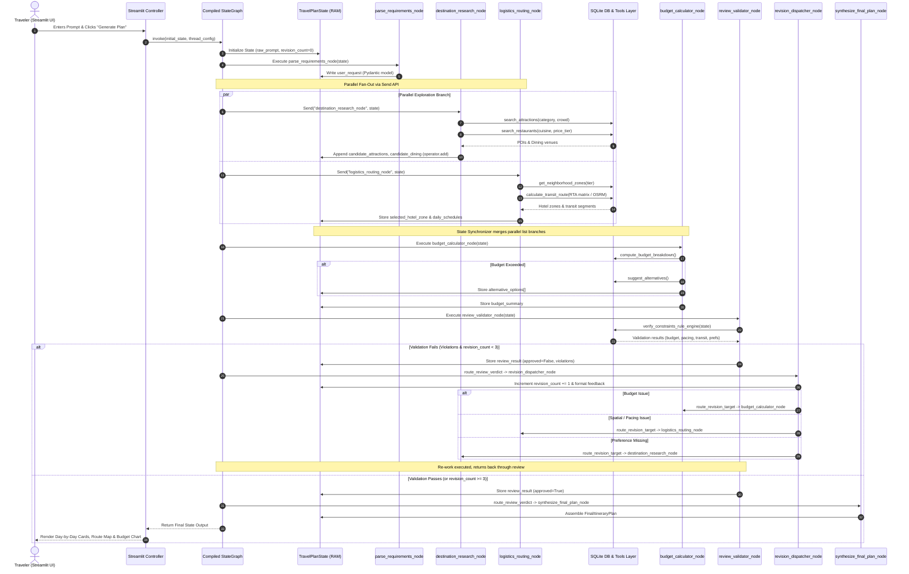
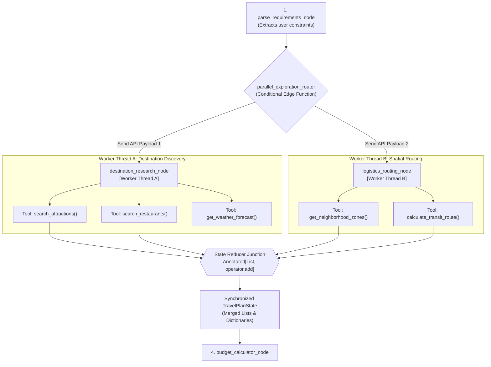
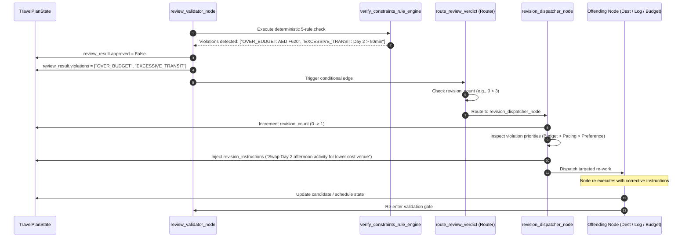
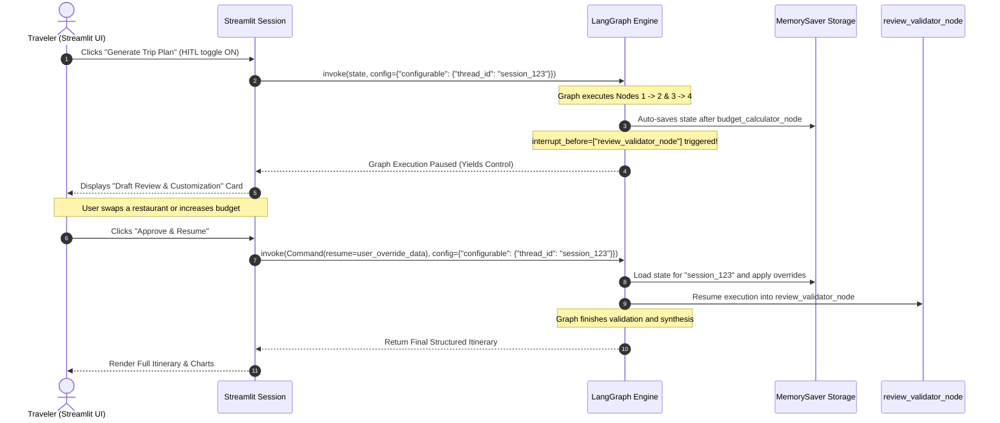

# Multi-Agent Execution Playbook & Runtime Lifecycle
## Dubai AI Travel Planning System (LangGraph Engine)

---

## 1. Overview & Purpose

This **Playbook** defines the operational execution flow of the Dubai AI Travel Planning System. It documents how the LangGraph multi-agent pipeline is invoked, how state transitions through each specialized agent node, how parallel worker branches are triggered via the `Send` API, and how feedback revision loops operate.

It serves as the definitive reference for developers and engineers building, testing, and debugging the multi-agent graph.

---

## 2. End-to-End System Execution Sequence

This sequence diagram illustrates the complete execution flow from the initial natural-language user prompt in Streamlit to the final rendered itinerary, highlighting parallel execution and conditional review loops.



---

## 3. Deep-Dive: Parallel Agent Fan-Out & State Reducers

A primary capability of LangGraph is dynamic concurrency using the **`Send` API**. Instead of executing destination research and logistics sequentially, the graph forks both nodes into concurrent worker threads.

### Parallel Fan-Out Architecture



### State Reducer Implementation Pattern

When two nodes run in parallel and both write to state, LangGraph requires an **annotated reducer** to prevent `INVALID_CONCURRENT_GRAPH_UPDATE` exceptions.

```python
from typing import TypedDict, Annotated, List, Dict, Any
import operator
from langgraph.types import Send

# 1. State definition with reducers for parallel writes
class TravelPlanState(TypedDict):
    user_request: UserTravelRequest
    # operator.add ensures parallel appends are merged, not overwritten
    candidate_attractions: Annotated[List[ActivityItem], operator.add]
    candidate_dining: Annotated[List[ActivityItem], operator.add]
    selected_hotel_zone: Dict[str, Any]
    daily_schedules: List[DailyPlan]
    ...

# 2. Router returning Send objects
def parallel_exploration_router(state: TravelPlanState) -> List[Send]:
    """Dynamically spawns parallel nodes with isolated state contexts."""
    return [
        Send("destination_research_node", state),
        Send("logistics_routing_node", state)
    ]
```

---

## 4. Deep-Dive: Self-Correction & Feedback Revision Loop

When the **Review Node** flags one or more constraint violations (e.g., budget exceeded, excessive travel time between activities, missing cultural spots), it triggers the **Revision Dispatcher**.



### Edge Decision Matrix

| Condition | `revision_count` | Router Verdict | Next Target Node |
| :--- | :--- | :--- | :--- |
| `approved == True` | Any | `synthesize_final_plan_node` | UI Assembly |
| `approved == False` | $< 3$ | `revision_dispatcher_node` | Budget, Logistics, or Destination Node |
| `approved == False` | $\ge 3$ (Hard Cap) | `synthesize_final_plan_node` | UI Assembly (with `[PARTIAL_VALIDATION]` badge) |

---

## 5. Human-in-the-Loop Interrupt & Resume Lifecycle

For interactive control, the system can pause execution right after budget estimation, giving travelers the opportunity to inspect intermediate drafts before final review.



---

## 6. Node-by-Node State Mutation Reference

This table outlines how the centralized `TravelPlanState` dictionary evolves through each step of the pipeline:

| Step | Executing Node | State Keys Read | State Keys Mutated | Deterministic Output Schema |
| :---: | :--- | :--- | :--- | :--- |
| **0** | Graph Input | *(None)* | `raw_prompt`, `thread_id` | Initial dictionary |
| **1** | `parse_requirements_node` | `raw_prompt` | `user_request` | `UserTravelRequest` (Pydantic) |
| **2a**| `destination_research_node` | `user_request`, revision notes | `candidate_attractions`, `candidate_dining` | `List[ActivityItem]` (appended) |
| **2b**| `logistics_routing_node` | `user_request`, candidates | `selected_hotel_zone`, `daily_schedules` | `Dict`, `List[DailyPlan]` |
| **3** | `budget_calculator_node` | `daily_schedules`, hotel zone | `budget_summary`, `alternative_options` | `BudgetSummary`, `List[AlternativeOption]` |
| **4** | `review_validator_node` | Full state | `review_result` | `ReviewResult` (Pass/Fail) |
| **5** | `revision_dispatcher_node` | `review_result` | `revision_count`, error instructions | State counter increment |
| **6** | `synthesize_final_plan_node` | Complete validated state | `final_plan` | `FinalItineraryPlan` (Pydantic) |

---

## 7. How to Invoke the Graph Programmatically

### A. Python Headless Invocation (CLI / Script / Test)

```python
import uuid
from src.graph.builder import build_travel_planner_graph
from src.models.request import UserTravelRequest

# 1. Compile the graph
app = build_travel_planner_graph()

# 2. Setup thread ID for state checkpointing
thread_id = str(uuid.uuid4())
config = {"configurable": {"thread_id": thread_id}}

# 3. Define initial input payload
initial_input = {
    "raw_prompt": (
        "Plan a 4-day trip to Dubai with a budget of AED 5,000, excluding flights. "
        "I enjoy cultural attractions, local food, and beaches. "
        "I prefer affordable hotels and want to avoid crowded places."
    ),
    "revision_count": 0,
    "error_log": [],
    "node_traces": []
}

# 4. Stream or invoke execution
print("=== Starting LangGraph Travel Planner ===")
final_state = app.invoke(initial_input, config=config)

# 5. Access final structured deliverable
plan = final_state.get("final_plan")
print(f"Trip Title: {plan.trip_title}")
print(f"Total Cost: AED {plan.budget_breakdown.total_cost:,.2f}")
print(f"Days Scheduled: {len(plan.days)}")
```

---

### B. Streamlit Streaming & Event Inspection

```python
import streamlit as st
from src.graph.builder import build_travel_planner_graph

# Compile graph once per session
if "graph_app" not in st.session_state:
    st.session_state.graph_app = build_travel_planner_graph()

app = st.session_state.graph_app
config = {"configurable": {"thread_id": st.session_state.session_id}}

# Stream node execution events to update UI in real time
with st.status("Executing Multi-Agent Workflow...", expanded=True) as status:
    for event in app.stream(initial_input, config=config):
        for node_name, state_update in event.items():
            st.write(f"Completed node: **{node_name}**")
            # Capture intermediate state snapshots for Tab 2 (Trace Inspector)
            st.session_state.trace_logs.append({
                "node": node_name,
                "update": state_update
            })
    status.update(label="Itinerary Generation Complete!", state="complete")
```

---

## 8. Failure Handling & Recovery Protocols

| Failure Scenario | Detection Mechanism | Recovery Action | User-Facing Indication |
| :--- | :--- | :--- | :--- |
| **LLM Rate Limit (429) / Transient Error** | `tenacity` retry wrapper | Exponential backoff (3 attempts: 2s, 4s, 8s); optional failover provider | Minor execution delay notification |
| **Output JSON Malformed** | Pydantic `ValidationError` | Node re-invoked with syntax correction prompt (max 2 retries) | Transparent self-healing |
| **Budget Exceeded after 3 Cycles** | `revision_count >= 3` | Graph forces synthesis with lower-tier hotel zones & cheaper dining substitutions | Visible `[PARTIAL_VALIDATION]` warning badge in UI |
| **Weather API Network Failure** | `httpx.TimeoutException` | Default to Dubai historical seasonal average temperature | Weather context noted as `historical_baseline` |
| **OSRM Route Engine Offline** | Network connection error | Instant switch to local **Haversine formula** detour math | Transit duration tagged as `haversine_local` |
