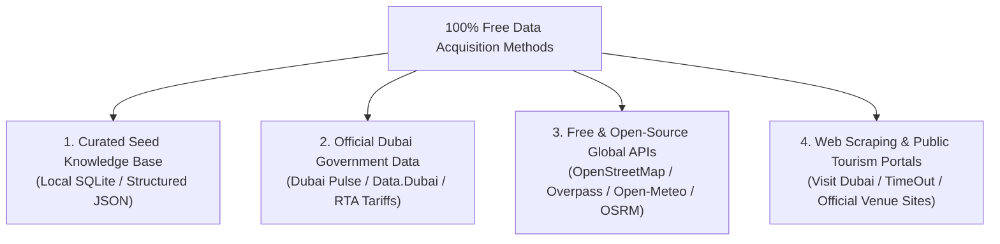
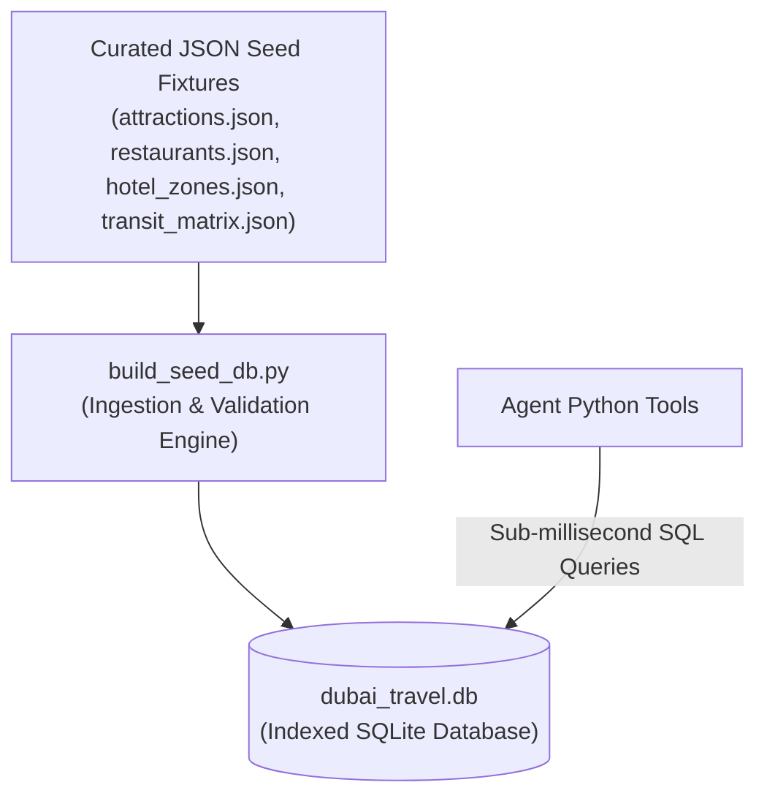
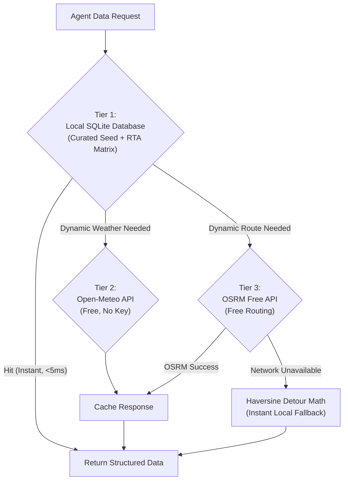

# Data Acquisition & Sourcing Research
## Dubai AI Travel Planning System (100% Free & Open-Source Stack)

---

## 1. Executive Summary & Research Purpose

The **Dubai AI Travel Planning System** requires realistic, accurate, and geographically coherent data across five key domains:
1. **Attractions & Cultural Landmarks:** Heritage sites, iconic landmarks, beaches, parks, theme parks, opening hours, crowd profiles, and admission fees in AED.
2. **Dining & Culinary Experiences:** Authentic Emirati food, budget cafeterias, midscale cafes, fine dining, and geographic distribution across Old and New Dubai.
3. **Logistics & Spatial Transit:** Geographic coordinates (latitude/longitude), transit distances, realistic travel durations, and transit modes (Dubai Metro, RTA buses, Dubai Tram, abras, taxis).
4. **Accommodation Zones & Pricing:** Realistic average nightly hotel rates by neighborhood (Deira, Bur Dubai, Downtown, Dubai Marina, Al Barsha) categorized by tier.
5. **Weather & Environmental Factors:** Seasonal temperature, precipitation, and UV indices to determine optimal indoor vs. outdoor scheduling.

> [!IMPORTANT]
> **Zero-Cost Architectural Constraint:** This project is deliberately engineered with **zero paid external API dependencies**. All commercial, metered, and credit-card-gated APIs (such as Google Places, Google Routes, and Amadeus) are strictly excluded. The system relies entirely on **pre-seeded curated local databases, official government open datasets, and free, unmetered open-source APIs**.

This research document evaluates all zero-cost data acquisition methods, contrasts their trade-offs, and defines an actionable **multi-tier sourcing strategy** optimized for a deterministic, resilient, and demo-ready multi-agent system.

---

## 2. Agent Data Needs Matrix

| Agent | Data Needed | Critical Attributes | Tolerable Latency | Primary Free Source | Fallback Mechanism |
| :--- | :--- | :--- | :--- | :--- | :--- |
| **Destination Agent** | Tourist POIs, cultural spots, beaches, restaurants | Name, category, neighborhood, lat/long, ticket AED, crowd level, indoor/outdoor flag | < 50ms | Curated local SQLite table | OpenStreetMap Overpass API |
| **Logistics Agent** | Route distances, transit times, neighborhood adjacency | Origin/destination coordinates, Metro line stops, taxi vs. public transport durations | < 50ms | Precomputed RTA distance & fare matrix (SQLite) | OSRM (Free Open Source Routing Machine) / Haversine |
| **Budget Agent** | Activity entry fees, food costs, transit fares, hotel rates | Ticket AED, meal averages, RTA Nol fare zones, taxi flag fall + per-km rates | < 10ms | Exact static AED price tables in SQLite | Deterministic heuristic baselines |
| **Review Agent** | Validation constraints & opening rules | Operating hours, Friday prayer shifts, maximum daily travel limits | < 10ms | Deterministic rule constants & SQLite metadata | Hardcoded sanity constraints |

---

## 3. Comprehensive Analysis of Free & Open Data Acquisition Methods



---

### 3.1 Method 1: Curated Seed Knowledge Base (Core Foundation)

Building a high-quality, pre-verified **Dubai Seed Dataset** stored in a local SQLite database (`data/database/dubai_travel.db`). This guarantees that the system works 100% out of the box with zero network latency, zero costs, and no API keys.



#### Seed Dataset Composition:
1. **Attractions Table (50+ Curated Dubai POIs):**
   * *Heritage & Culture:* Al Fahidi Historical Neighbourhood, Dubai Museum, Al Shindagha Museum, Jumeirah Mosque, Etihad Museum, Sheikh Saeed Al Maktoum House, Coffee Museum, Coins Museum.
   * *Iconic Modern Landmarks:* Burj Khalifa At The Top, Museum of the Future, Dubai Frame, Dubai Fountain, Palm Jumeirah Monorail, Dubai Miracle Garden, Dubai Glow Garden.
   * *Beaches & Coastal (Free/Budget):* Kite Beach, JBR Beach, Sunset Beach (Umm Suqeim), Al Mamzar Beach Park, La Mer.
   * *Markets & Souks:* Gold Souk, Spice Souk, Textile Souk, Al Seef Heritage Souk.
2. **Dining Table (40+ Verified Restaurants):**
   * *Authentic Emirati & Middle Eastern:* Al Fanar Restaurant & Cafe, Arabian Tea House (Al Fahidi), Al Ustad Special Kabab, Bait Al Mandi.
   * *Budget & Street Food:* Ravi Restaurant (Satwa), Bu Qtair (Umm Suqeim fish shack), Karachi Darbar, Zaroob.
   * *Midscale & Waterfront:* Operation Falafel (JBR), Time Out Market (Downtown), Pier 7 casual spots.
3. **Hotel Zones Table:**
   * Average nightly pricing for Budget (AED 150–300), Midscale (AED 350–650), and Luxury (AED 900+) across:
     * *Deira / Bur Dubai* (Best for culture, affordable hotels, metro access)
     * *Al Barsha* (Central budget hub near Mall of the Emirates)
     * *Downtown Dubai* (High-end, central, iconic views)
     * *Dubai Marina / JBR* (Beachside, nightlife, upscale)
4. **Precomputed Transit Matrix:**
   * Travel distances, Metro durations, taxi durations, and official RTA fares between all major Dubai neighborhood pairs.

---

### 3.2 Method 2: Official Dubai Government & Open Data Portals

Dubai provides public government datasets under the **Dubai Open Data Law** via Digital Dubai and the Roads and Transport Authority (RTA).

#### A. Dubai Pulse & Data.Dubai (`dubaipulse.gov.ae` / `data.dubai.gov.ae`)
* **What it offers:**
  * Official register of tourism licenses, historical heritage sites, public parks, and cultural centers.
  * Spatial datasets of Dubai Metro stations, bus routes, and marine transport lines managed by the RTA.
* **Access Protocol:** Free public access, downloadable CSV/JSON datasets.
* **Strengths:** 100% authoritative, government-verified metadata, completely free.
* **Limitations:** Infrequent refresh cycles for commercial pricing, ticket costs often omitted; best used for offline seeding.

#### B. Dubai RTA Official Transit Tariffs (Static Calculation Rules)
* **What it offers:** The official public transportation fare rules published by the Roads and Transport Authority.
* **Tariff Architecture (AED):**
  * **Dubai Metro & Tram (Nol Card - Silver / Red Ticket):**
    * Tier 1 (Within 1 Zone): **AED 3.00 – 4.00**
    * Tier 2 (Between 2 Adjacent Zones): **AED 5.00 – 6.00**
    * Tier 3 (Exceeding 2 Zones): **AED 7.50 – 8.50**
  * **Dubai Taxi (DTC / RTA):**
    * Daytime Flag Fall (Base Fare): **AED 12.00**
    * Per-Kilometer Rate: **AED 1.97 – 2.09 / km**
    * Minimum Fare per Ride: **AED 12.00**
  * **Traditional Abra (Dubai Creek Crossing):**
    * Motorized Abra: **AED 1.00 – 2.00** per crossing.
* **Verdict:** Indispensable reference data. Built directly into the system's local SQLite lookup table to provide 100% accurate, realistic transit pricing with zero API costs.

---

### 3.3 Method 3: Free & Open-Source Global APIs

These services are 100% free, require no credit card, and require no commercial subscription.

#### A. Open-Meteo Weather API (Free, No Key Required)
* **Endpoint:** `https://api.open-meteo.com/v1/forecast`
* **Query Parameters:** `latitude=25.2048&longitude=55.2708&daily=weathercode,temperature_2m_max,temperature_2m_min,uv_index_max,precipitation_probability_max&timezone=Asia%2FDubai`
* **Strengths:** Completely free, zero authentication, no API key required, reliable forecasts, >99.9% uptime.
* **Usage in Project:** Enables the Destination and Logistics nodes to dynamically schedule indoor vs. outdoor activities based on forecast temperature and UV index.

#### B. OpenStreetMap via Overpass API (Free POI Discovery)
* **What it offers:** Unrestricted spatial query access to all tagged POIs in Dubai without commercial fees.
* **Query Technique (Overpass QL):**
  ```overpassql
  [out:json][timeout:25];
  // Dubai Bounding Box: 24.8 to 25.4 Lat, 55.0 to 55.6 Lng
  (
    node["tourism"="attraction"](24.8, 55.0, 25.4, 55.6);
    node["historic"](24.8, 55.0, 25.4, 55.6);
    node["amenity"="restaurant"]["cuisine"](24.8, 55.0, 25.4, 55.6);
  );
  out body;
  >;
  out skel qt;
  ```
* **Python Client:** `requests` / `httpx` to `https://overpass-api.de/api/interpreter`.
* **Strengths:** Free global community map, accurate GPS coordinates, street addresses.
* **Limitations:** Opening hours and admission fees can be sparse; ideal for supplementary POI enrichment.

#### C. Open Source Routing Machine (OSRM) & Haversine Formula
* **What it offers:** Free road routing, distance calculation, and driving durations between coordinate pairs.
* **Public Endpoint:** `http://router.project-osrm.org/route/v1/driving/{lon1},{lat1};{lon2},{lat2}?overview=false`
* **Local Fallback (Haversine Formula):** A pure Python calculation computing great-circle distance between two latitude/longitude points:
  $$\text{distance} = 2r \arcsin\left(\sqrt{\sin^2\left(\frac{\Delta \text{lat}}{2}\right) + \cos(\text{lat}_1)\cos(\text{lat}_2)\sin^2\left(\frac{\Delta \text{lon}}{2}\right)}\right)$$
  Multiplying the straight-line distance by an urban detour factor (typically $1.35\times$ for Dubai's highway grid) provides an instant, offline estimate of driving distance and duration without any external service dependency.

---

### 3.4 Method 4: Automated Web Scraping & Public Tourism Portals

Offline extraction of structured data from public tourism portals using Python (`BeautifulSoup4`, `httpx`).

#### Key Target Portals:
1. **Visit Dubai (`visitdubai.com`):** Curated neighborhood breakdowns, free beach listings, and cultural sites.
2. **TimeOut Dubai (`timeoutdubai.com`):** Curated reviews of authentic budget cafeterias and midscale dining.
3. **Official Venue Ticket Portals:** Verified admission pricing for Burj Khalifa, Museum of the Future, and Dubai Frame.

#### Scraping Governance:
* **One-Time Offline ETL:** Scrape once offline to populate the JSON seed fixtures. Zero web scraping occurs during runtime user requests, ensuring sub-second response times and zero IP blocking risk.

---

## 4. Comparison of Free Data Acquisition Options

| Evaluation Criterion | 1. Curated Seed SQLite DB | 2. Official Dubai Portals / RTA | 3. Open-Meteo Weather | 4. OpenStreetMap / Overpass | 5. OSRM Free Routing |
| :--- | :--- | :--- | :--- | :--- | :--- |
| **Monetary Cost** | **100% Free** | **100% Free** | **100% Free** | **100% Free** | **100% Free** |
| **API Key Required?** | **No** | **No** | **No** | **No** | **No** |
| **Credit Card / Billing?** | **None** | **None** | **None** | **None** | **None** |
| **Query Latency** | **< 5ms (In-memory)** | Static reference | 150ms – 400ms | 800ms – 2.5s | 200ms – 600ms |
| **Accuracy for Dubai** | High (Pre-verified) | Authoritative (Govt) | High (Standardized) | Good (Community) | Good (Road network) |
| **AED Cost Data** | Exact verified AED | Exact official fares | N/A | Missing | N/A |
| **Setup Complexity** | Zero (Bundled in repo) | Pre-seeded | Very Low (1 GET call) | Low | Low |
| **Offline Capable?** | **Yes (100%)** | **Yes** | No (cached) | No (cached) | No (Haversine fallback) |
| **Role in Project** | **Core Foundation** | **Fare Matrix Base** | **Live Weather Context** | **POI Enrichment** | **Route Durations** |

---

## 5. Recommended 100% Free Multi-Tier Sourcing Strategy

The system eliminates all commercial APIs in favor of a **resilient, zero-cost layered architecture**:



### Strategic Tier Roles:
* **Tier 1 (Core Knowledge Base — Embedded SQLite):** Pre-seeded with 50+ attractions, 40+ restaurants, 6 hotel zones, and complete RTA transit matrices. Serves 95%+ of all queries instantly without external network requests.
* **Tier 2 (Live Meteorological Context — Open-Meteo):** Free, keyless API called at runtime to inject current Dubai seasonal temperatures and UV index, guiding indoor/outdoor schedule planning.
* **Tier 3 (Open Route Distance Engine — OSRM + Haversine):** Free road routing engine to compute travel times between arbitrary coordinate pairs, backed by a mathematical Haversine fallback if offline.

---

## 6. Implementation Architecture & Data Pipeline

### 6.1 Ingestion Script: `data/build_seed_db.py`

This script parses curated JSON seed files, validates schemas, creates SQLite tables, and builds query indexes.

```python
"""
build_seed_db.py
Parses curated JSON files and builds the local SQLite database: data/database/dubai_travel.db
100% free, local-first data architecture.
"""
import json
import sqlite3
from pathlib import Path

DATA_DIR = Path(__file__).resolve().parent
SEED_DIR = DATA_DIR / "seed"
DB_PATH = DATA_DIR / "database" / "dubai_travel.db"

def init_db():
    DB_PATH.parent.mkdir(parents=True, exist_ok=True)
    conn = sqlite3.connect(DB_PATH)
    cursor = conn.cursor()

    # 1. Attractions Schema
    cursor.execute("""
    CREATE TABLE IF NOT EXISTS attractions (
        id TEXT PRIMARY KEY,
        name TEXT NOT NULL,
        category TEXT NOT NULL,
        neighborhood TEXT NOT NULL,
        latitude REAL NOT NULL,
        longitude REAL NOT NULL,
        price_aed REAL DEFAULT 0.0,
        typical_duration_hours REAL NOT NULL,
        crowd_index TEXT CHECK(crowd_index IN ('low', 'medium', 'high')),
        is_indoor BOOLEAN NOT NULL DEFAULT 0,
        opening_time TEXT,
        closing_time TEXT,
        description TEXT
    );
    """)

    # 2. Dining Schema
    cursor.execute("""
    CREATE TABLE IF NOT EXISTS dining (
        id TEXT PRIMARY KEY,
        name TEXT NOT NULL,
        cuisine_type TEXT NOT NULL,
        price_tier TEXT CHECK(price_tier IN ('budget', 'midscale', 'fine_dining')),
        neighborhood TEXT NOT NULL,
        latitude REAL NOT NULL,
        longitude REAL NOT NULL,
        average_meal_cost_aed REAL NOT NULL,
        is_authentic_local BOOLEAN DEFAULT 0
    );
    """)

    # 3. Hotel Zones Schema
    cursor.execute("""
    CREATE TABLE IF NOT EXISTS hotel_zones (
        zone_id TEXT PRIMARY KEY,
        neighborhood TEXT NOT NULL,
        avg_budget_rate_aed REAL NOT NULL,
        avg_midscale_rate_aed REAL NOT NULL,
        avg_luxury_rate_aed REAL NOT NULL,
        metro_accessible BOOLEAN NOT NULL,
        description TEXT
    );
    """)

    # 4. Transit Matrix Schema (RTA Fares & Times)
    cursor.execute("""
    CREATE TABLE IF NOT EXISTS transit_matrix (
        origin_zone TEXT NOT NULL,
        destination_zone TEXT NOT NULL,
        metro_fare_aed REAL NOT NULL,
        metro_time_min INTEGER NOT NULL,
        taxi_est_aed REAL NOT NULL,
        taxi_time_min INTEGER NOT NULL,
        PRIMARY KEY (origin_zone, destination_zone)
    );
    """)

    conn.commit()
    return conn
```

---

### 6.2 Free Road Routing Client (OSRM + Haversine Fallback)

```python
"""
osrm_client.py
Free road routing and travel time calculation using OSRM with local Haversine fallback.
Zero API keys, zero cost.
"""
import math
import httpx

def calculate_haversine_distance_km(lat1: float, lon1: float, lat2: float, lon2: float) -> float:
    """Calculate distance in km using Haversine formula with a 1.35x urban detour factor."""
    R = 6371.0  # Earth radius in km
    dlat = math.radians(lat2 - lat1)
    dlon = math.radians(lon2 - lon1)
    a = (math.sin(dlat / 2) ** 2 +
         math.cos(math.radians(lat1)) * math.cos(math.radians(lat2)) *
         math.sin(dlon / 2) ** 2)
    c = 2 * math.atan2(math.sqrt(a), math.sqrt(1 - a))
    return round(R * c * 1.35, 2)

def estimate_driving_time_minutes(distance_km: float) -> int:
    """Estimate driving time assuming Dubai average urban transit speed of 45 km/h."""
    return max(5, int((distance_km / 45.0) * 60))

def get_free_route(lat1: float, lon1: float, lat2: float, lon2: float) -> dict:
    """Query free OSRM public API with automatic Haversine fallback."""
    url = f"http://router.project-osrm.org/route/v1/driving/{lon1},{lat1};{lon2},{lat2}?overview=false"
    try:
        resp = httpx.get(url, timeout=3.0)
        if resp.status_code == 200:
            data = resp.json()
            route = data["routes"][0]
            return {
                "distance_km": round(route["distance"] / 1000.0, 2),
                "duration_minutes": max(5, int(route["duration"] / 60.0)),
                "source": "osrm"
            }
    except Exception:
        pass
    
    # Fallback to local Haversine calculation
    dist = calculate_haversine_distance_km(lat1, lon1, lat2, lon2)
    return {
        "distance_km": dist,
        "duration_minutes": estimate_driving_time_minutes(dist),
        "source": "haversine_local"
    }
```

---

## 7. Action Plan & Engineering Checklist

1. [x] **Data Requirements Defined:** Exact schemas for POIs, dining, transit, and hotel zones identified.
2. [x] **Commercial APIs Removed:** Eliminated Google Places, Google Routes, and Amadeus API requirements.
3. [ ] **Build Curated Seed Fixtures:** Populate `attractions.json` (50 entries), `restaurants.json` (40 entries), `hotel_zones.json` (6 zones), and `transit_matrix.json` (15 zone pairs).
4. [ ] **Implement Database Ingestion Script:** Create `data/build_seed_db.py` to compile JSON fixtures into `dubai_travel.db`.
5. [ ] **Implement Repository Facade:** Create `src/data_access/repository.py` providing unified SQL query methods (`get_attractions_by_interest()`, `get_dining_by_budget()`, `get_transit_estimate()`).
6. [ ] **Integrate Open-Meteo Client:** Implement zero-key weather fetch in `src/data_access/open_meteo.py` to inject current Dubai seasonal context into agent prompts.
7. [ ] **Implement Free Routing Client:** Build `src/data_access/osrm_client.py` using free OSRM routing with local Haversine fallback.
